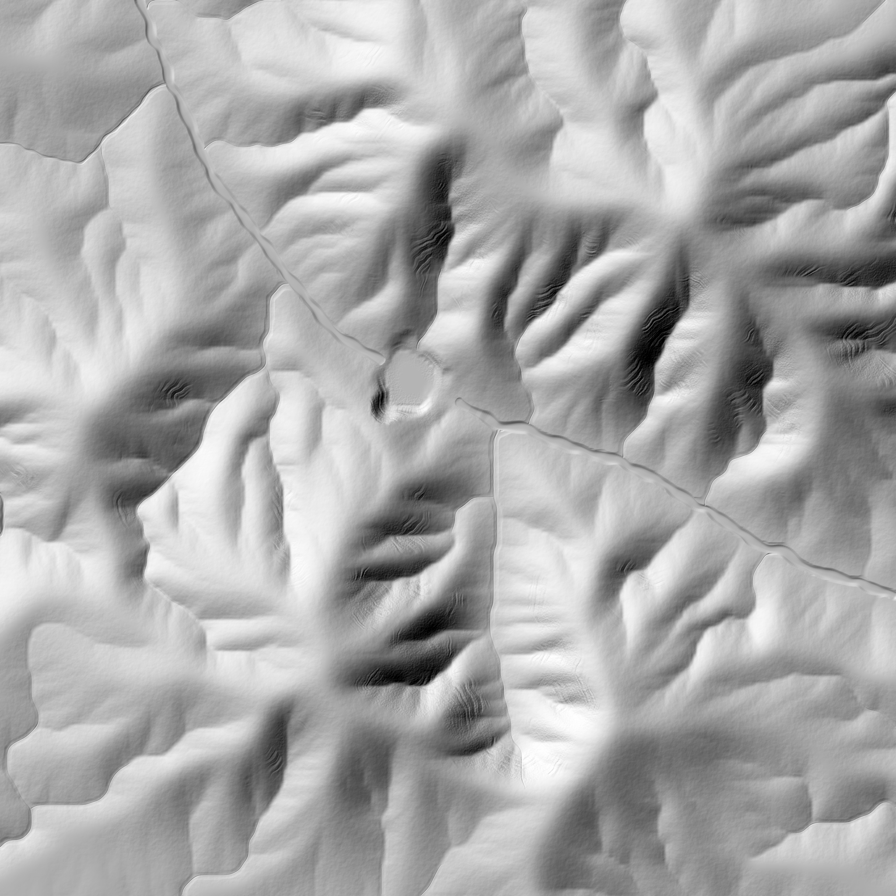

# Landform

Draw rivers, lakes and high ground in Godot, then grow terrain around them. Hold a patch you want to keep, edit the drawing and regrow the surrounding land. Double-click a river or lake in the dock to frame it in the 3D viewport.



## Try a valley from the command line

Install Rust with Cargo. From the repository root, run:

```sh
cargo run --locked --release -p landform_cli -- generate --drawing drawings/valley --seed 11 --out target/valley
```

Open `target/valley/hillshade.png` to see the relief and `target/valley/water.png` to see where the water settled. Change the seed or try another [example drawing](drawings). The CLI runs independently of Godot.

## Install the Godot addon

The editor extension targets **Windows x86-64**. It has been tested with [Godot 4.8 development build `c016f2200`](https://github.com/godotengine/godot/commit/c016f22009) and [Terrain3D 1.1.0 stable](https://github.com/TokisanGames/Terrain3D/releases/tag/v1.1.0-stable). Use the same Godot executable to generate the Rust bindings and to open the project.

1. Install the Rust MSVC toolchain, Visual Studio C++ Build Tools, and Git Bash. Install Terrain3D in your Godot project so its addon is at `res://addons/terrain_3d/`.
2. From the Landform checkout in Git Bash, build the native libraries:

   ```sh
   export GDRUST_GODOT_BIN="C:/path/to/godot.console.exe"
   bash tools/build.sh
   ```

3. Copy the entire `addon/landform/` folder, including the generated `bin/`, into your project's `addons/landform/`. Open the project and enable **Landform** under **Project → Project Settings → Plugins**.

## Make your first land

1. Copy `res://addons/landform/examples/first_land.tscn` into your project as `res://first_land.tscn` and open the copy. It has a land view, a default generation config and a six-colour ground palette.
2. Choose **Project → Tools → Open Landform**. In the dock, choose a size, country and seed, choose a new `.lfland` path under **File**, then click **Make land**. To explore a ready-made valley, copy `crates/core/tests/fixtures/stage1/valley_128.lfland` into the project, assign it to the **Land File** property on the **LandView** node, save the scene and reopen it.
3. Draw a river, regrow the land, then double-click its entry to jump to it. Use Godot's Undo to step back.

To open this authoring scene from other scenes, set the project setting `landform/editor/authoring_scene` to `res://first_land.tscn`. For **Walk from here**, set `landform/walk_preview_scene` to your own playable scene. It receives `--land=<absolute path>`, `--camera=walk` and `--at=<x>,<z>` through `OS.get_cmdline_user_args()`. The preview opens the last saved terrain. When the editor has pending edits, it also passes `--last-saved-land`.

## Development

The Rust [terrain engine](crates/core) generates terrain and reads and writes land files. The [CLI](crates/cli) renders maps and edits saved land. The [GDExtension](crates/godot) exposes the engine to Godot, and the [editor plugin](addon/landform/editor) supplies the authoring tools.

```sh
cargo test --locked --release -p landform_core -p landform_cli
```

The [region recipes](regions) identify the USGS elevation tiles needed for real-world terrain and carry their source attribution. The [MIT license](LICENSE) covers Landform.
